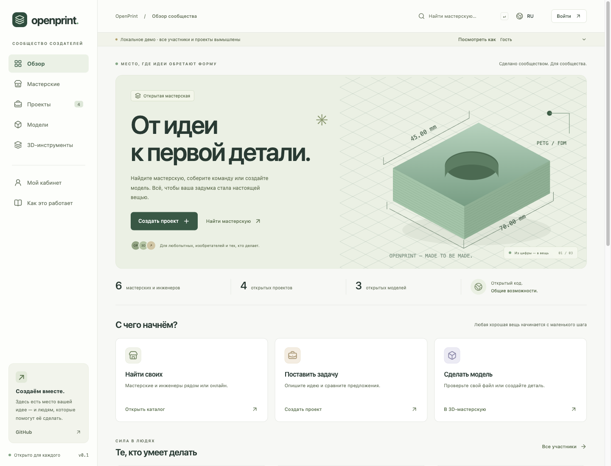

# OpenPrint

**From an idea to a finished part. An open community for 3D printing, engineering, and local makers.**

[Русский](README.md) · [Self-hosting](docs/SELF_HOSTING.md) · [Architecture](docs/ARCHITECTURE.md) · [Contributing](CONTRIBUTING.md) · [Validation](docs/VALIDATION.md)

Run OpenPrint for a city, maker club, or small network of workshops. Customers share a brief; makers ask questions and send offers; both parties discuss scope and record the exact agreement. There is no required Vercel, Supabase, AI, or email-service account.



## Try it locally

Requires **Node.js 24 LTS**. Clone this repository, then:

```sh
npm ci
npm run demo
```

Open **http://localhost:5173**. Switch between fictional customers, workshops, an engineer, and the moderator using the demo bar. All sample people, companies, and projects are fictional. Demo data lives in `.local/demo`.

**Do not expose demo mode publicly.** It includes one-click access to fictional accounts. Real instances start empty, have no default administrator password, and have no demo sign-in endpoint.

## Who is it for?

- Customers: public or direct briefs, private attachments, comparable offers, recorded agreements, and customer-confirmed completion.
- Workshops and engineers: self-managed profiles, an open project board, direct requests, questions before quoting, immutable offer revisions, and delivery status.
- Model creators: share original designs with attribution and a CC license, moderator review, and publication controls.
- Moderators: review profiles and model files, handle reports, hide inappropriate content, and inspect decision history.
- Community operators: one Node.js process, SQLite, local private uploads, CLI administrator setup and recovery, backup/restore instructions, and Docker Compose.
- Visitors: search makers, download approved open models, inspect STL/OBJ files locally, and build custom-size parts without signing in.

The interface supports Russian and English. User-generated content stays in its original language. The optional OpenStreetMap map loads only on request; core workflows require no third-party API calls.

## Run a real community

```sh
npm ci
npm run build
cp .env.example .env
npm run admin -- operator@example.org
npm start
```

The administrator command prints a private, one-use setup link that expires in 30 minutes. Open **http://localhost:3000**. Configure your public HTTPS origin, operator contact, moderation process, and backups before exposing the instance. See [self-hosting](docs/SELF_HOSTING.md).

You can also keep the source only on GitHub, without operating a public site. A running shared community still needs a computer or server.

## Deliberate limits

OpenPrint 0.1 is intended for small communities. It does not provide payments, escrow, identity verification, automatic CAD safety checks, antivirus scanning, or dispute arbitration. Makers and customers arrange payments and delivery directly. A 3D preview is not a printability or engineering certification. Physical printing has not been validated.

Use one application process with local storage. Team memberships, horizontal scaling, SMTP, AI generation, SSR/SEO, automatic translation of member content, and Supabase account migration are outside this release. The operator can access server data; this is not end-to-end encryption. See [product scope](docs/PRODUCT.md), [privacy](PRIVACY.md), and [security](SECURITY.md).

## Development

```sh
npm run dev
npm run check
npx playwright install chromium
npm run test:e2e
npm run format:check
```

The test suite covers real API sessions and permissions, stale and concurrent offer acceptance, file access, paginated conversations, recovery, moderation, backup and restore, generated mesh topology, and complete browser workflows. Automated accessibility checks are included; they are not a claim of full WCAG compliance. See [validation](docs/VALIDATION.md).

## License and provenance

Code, UI, original SVG illustrations, and documentation are [MIT](LICENSE). Member-uploaded models have their own explicit licenses. Three fictional demo geometries are offered under CC0; their generator code remains MIT.

Inspired by [3d-online.app](https://3d-online.app), implemented separately. No production database, scraped company directory, private Git history, user files, or credentials were copied. Contributions welcome: [CONTRIBUTING.md](CONTRIBUTING.md).
