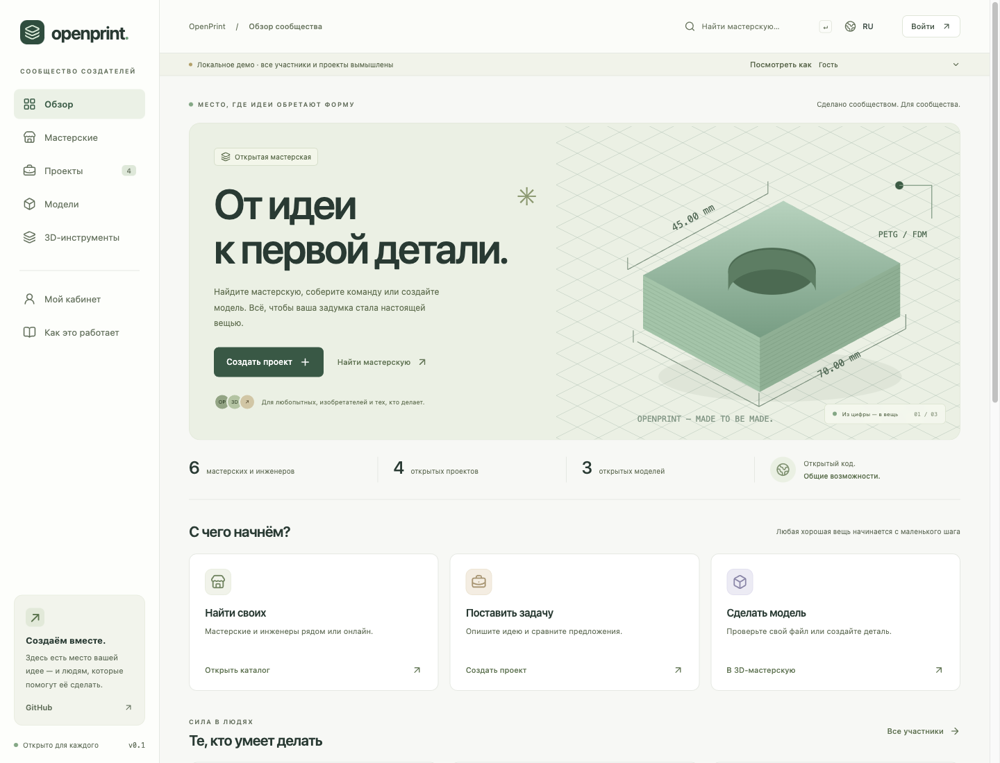

# OpenPrint

**От идеи к первой детали. Открытое сообщество 3D-печати, мастерских и инженеров.**

[English](README.en.md) · [Установка](docs/SELF_HOSTING.md) · [Как устроено](docs/ARCHITECTURE.md) · [Участвовать](CONTRIBUTING.md) · [Проверки и ограничения](docs/VALIDATION.md)

OpenPrint можно запустить для города, клуба, мейкерспейса или небольшой сети мастерских. Заказчик описывает задачу, мастерская или инженер предлагают условия, участники обсуждают детали и сохраняют договорённость. Без обязательных аккаунтов Vercel, Supabase, Google, платного AI и почтового провайдера.



Это отдельная реализация идеи [3d-online.app](https://3d-online.app). В неё не перенесены рабочая база, собранный каталог компаний, пользовательские файлы, приватная история Git или ключи исходного сервиса.

## Попробовать за две команды

Нужен **Node.js 24 LTS**. После клонирования репозитория:

```sh
npm ci
npm run demo
```

Откройте **http://localhost:5173**. В верхней полосе можно выбрать вымышленного заказчика, мастерскую, инженера или модератора и пройти весь процесс. Демо сохраняется в `.local/demo`, не затрагивая настоящую базу.

Демо предназначено **только для локального просмотра**: оно содержит быстрый вход в вымышленные аккаунты. Не открывайте этот режим в интернете и не ставьте перед ним публичный прокси. Реальный запуск по умолчанию не содержит ни участников, ни паролей, ни демо-входа.

## Полезно каждому участнику

| Участник            | Что можно сделать                                                                                                                                                            |
| ------------------- | ---------------------------------------------------------------------------------------------------------------------------------------------------------------------------- |
| Гость               | Найти мастерскую по городу, технологии и специализации; скачать открытые модели; пользоваться локальным 3D-конструктором и просмотром STL/OBJ                                |
| Заказчик            | Создать публичную задачу или личный запрос; приложить закрытую модель; обсудить условия; сравнить предложения; принять конкретную версию цены и срока; подтвердить результат |
| Мастерская          | Самостоятельно вести страницу; получать личные запросы; искать задачи; уточнять требования до оценки; отправлять новые версии предложения; передавать результат              |
| Инженер             | Принимать задачи на проектирование и восстановление деталей; обсуждать размеры и исходники; предлагать собственные условия                                                   |
| Автор модели        | Публиковать свои файлы с указанием автора и CC-лицензии; видеть статус проверки; снимать модель с публикации                                                                 |
| Модератор           | Проверять профили; просматривать и разрешать публикацию моделей; разбирать жалобы; скрывать материалы; видеть журнал решений                                                 |
| Владелец сообщества | Запустить всё на одном компьютере или сервере; хранить данные у себя; назначить модератора; сделать резервную копию и восстановить экземпляр                                 |

Интерфейс — на русском и английском. Тексты пользовательских профилей и проектов сохраняются на языке автора.

## Запустить настоящее сообщество

```sh
npm ci
npm run build
cp .env.example .env
npm run admin -- operator@example.org
npm start
```

`admin` выдаст **одноразовую ссылку** для установки пароля, действующую 30 минут. Сохраните её приватно. Откройте **http://localhost:3000**. Пароли по умолчанию отсутствуют; первый зарегистрировавшийся участник не становится администратором.

Для сервера настройте `APP_URL`, HTTPS и резервное копирование по [инструкции](docs/SELF_HOSTING.md). Есть [Docker Compose](compose.yaml). Содержание репозитория можно хранить только на GitHub, вообще не запуская общедоступный сайт. Если вы хотите работающую общую площадку, ей нужен запущенный компьютер или сервер.

## Основные решения

- **Данные у владельца:** SQLite и закрытые файлы в одном `DATA_DIR`. Основные функции не обращаются к сторонним API.
- **Цена не меняется незаметно:** предложение имеет неизменяемые версии; принимается конкретная версия. Одновременные принятия сериализуются транзакцией. Условия сделки фиксируются отдельно.
- **Файлы по правам:** вложение проекта доступно заказчику и выбранному исполнителю. Публичная модель становится доступной всем только после проверки модератором и явного согласия автора.
- **Результат подтверждают двое:** исполнитель отмечает готовность, заказчик завершает проект после получения. Оплата и доставка согласовываются участниками напрямую.
- **Разговор до оценки:** задать уточняющий вопрос можно до предложения цены. История сообщений загружается страницами; есть жалобы, блокировки и отметки прочитанного.
- **Полезные инструменты без регистрации:** просмотр STL/OBJ, габариты и конструктор блока, пластины, втулки с экспортом STL. Файл для просмотра остаётся в браузере.
- **Лёгкий старт:** без SMTP и AI-ключей; уведомления внутри приложения. Восстановление доступа организует оператор одноразовой ссылкой.
- **Карта необязательна:** OpenStreetMap загружается только после нажатия «Показать карту»; список работает и без тайлов. Соблюдайте [политику тайлов OSM](https://operations.osmfoundation.org/policies/tiles/).

## Границы версии 0.1

Это работающее основание для небольшого сообщества, **не сертифицированная торговая или производственная система**. Нет онлайн-оплаты, эскроу, автоматического разрешения споров, проверки личности, проверки пригодности изделия к эксплуатации и антивируса для CAD-файлов. Выбор материала — отправная точка для разговора, не инженерное заключение. Физическая печать образцов этой версии не проверялась.

Поддерживается один процесс приложения на локальном диске. Нет горизонтального масштабирования, нескольких сотрудников одной мастерской, автоматической почты, автоматического перевода контента или переноса пользователей из Supabase. Публичные страницы — клиентское React-приложение; SEO/SSR не равнозначны исходному Next.js-сервису. Ограничения и план развития: [PRODUCT.md](docs/PRODUCT.md).

Оператор сервера имеет технический доступ к данным: это не сквозное шифрование. Перед открытым запуском укажите контакт оператора, правила модерации и политику хранения резервных копий. Подробнее: [PRIVACY.md](PRIVACY.md) и [SECURITY.md](SECURITY.md).

## Разработка и проверки

```sh
npm run dev             # чистая локальная база; UI :5173, API :3000
npm run check           # типы → интеграционные проверки → сборка
npx playwright install chromium
npm run test:e2e        # браузерные сценарии на отдельной временной базе
npm run format:check
```

В `tests/platform.test.ts` проверяются роли, сессии, Origin-защита, версии и гонка предложений, приватность файлов, переписка длиннее 500 сообщений, восстановление доступа, модерация, очистка и восстановление резервной копии. В `tests/parts.test.ts` — замкнутость и объём создаваемых деталей. Браузерные тесты проходят путь заказчик → исполнитель → подтверждение результата, работу автора и модератора, а также автоматическую проверку доступности.

CI проверяет код и браузерные сценарии на Linux. Это не заменяет ручную проверку с участниками, нагрузочные испытания и проверку на реальном мобильном устройстве. Точные результаты и границы: [VALIDATION.md](docs/VALIDATION.md).

## Лицензии и участие

Код, интерфейс, авторские SVG-иллюстрации и документация — [MIT](LICENSE). Пользовательские модели имеют **отдельную**, явно выбранную автором лицензию. Три геометрических примера локального демо предоставляются как CC0; код их генерации остаётся MIT. [Подробности](THIRD_PARTY_NOTICES.md).

Будут полезны не только PR с кодом: переводы, улучшения сценариев, открытые параметрические детали, проверка запуска и обратная связь от настоящих мастерских. Начните с [CONTRIBUTING.md](CONTRIBUTING.md).
