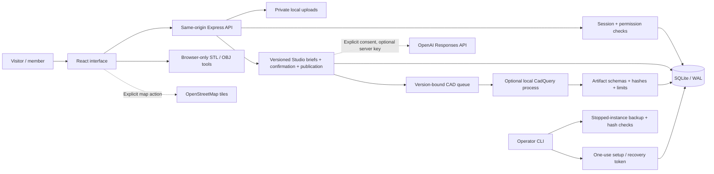

# Architecture

OpenPrint is a single self-hosted application: React, Express, local SQLite and private filesystem storage. Primary community workflows do not call a cloud provider.

## Code map

| Location                                                     | Responsibility                                                                   |
| ------------------------------------------------------------ | -------------------------------------------------------------------------------- |
| `src/App.tsx`, `src/core.tsx`                                | Navigation, state, localization, cancelled requests, notifications               |
| `src/Browse.tsx`                                             | Overview, directory, profiles, project board                                     |
| `src/NewProject.tsx`, `src/Project.tsx`                      | Briefs, offers, acceptance, delivery, conversations                              |
| `src/Workspace.tsx`                                          | Dashboard, provider profile, export, password, removal                           |
| `src/Models.tsx`, `src/Tools.tsx`                            | Licensed model sharing and browser-only tools                                    |
| `server/app.ts`                                              | Routes, validation, permissions and error responses                              |
| `server/domain.ts`                                           | Brief access, offer revisions, atomic acceptance, thread membership              |
| `server/database.ts`                                         | Schemas v1–v3, transactions, indexes, immutable snapshot triggers                |
| `src/Studio.tsx`, `shared/studio.ts`                         | Private CAD/CAM brief editor, components, confirmation and handoff               |
| `server/studio.ts`, `server/studio-ai.ts`                    | Ownership/version gates, durable AI call ledger, bounded Responses API           |
| `server/studio-geometry.ts`                                  | Deterministic FDM template checks, STL and packet manifests                      |
| `shared/cad.ts`, `server/cad.ts`, `server/cad-data.ts`       | Declarative CAD contracts, revisions, grants and exact handoffs                  |
| `server/cad-runner.ts`, `cad-worker/`                        | Durable queue, bounded native process, CadQuery compiler and artifact validation |
| `src/CadStudio.tsx`, `src/cad-preview.tsx`, `src/JobCad.tsx` | CAD editing, assembly preview and quotation-file access                          |
| `server/security.ts`                                         | Password hashing, sessions, bounded throttles, permission guards                 |
| `server/files.ts`                                            | Headers, names, quotas, ownership, reads and cleanup                             |
| `server/demo.ts`                                             | Opt-in fictional local demo, isolated from real data                             |
| `shared/validation.ts`, `shared/parts.ts`                    | Schemas, exact minor-unit amounts, deterministic meshes                          |
| `scripts/`, `tests/`                                         | Operator tools, backup, API/state/security and browser tests                     |

## Data and access

`users` have a self-asserted email, scrypt password hash and server-owned role. Email ownership is not automatically verified. `sessions` store only SHA-256 digests of random 256-bit tokens; the raw token is in an HttpOnly cookie, never localStorage. Seven-day sessions are revoked on logout, recovery, password change and account closure as appropriate.

Operator setup creates a one-use token that can activate administrator privileges **only on redemption**, in the same transaction that changes the password and revokes prior sessions. An already registered email address does not gain privileges while a setup link is pending. Recovery with `--recover` never promotes a member.

One `profile` belongs to one user and represents a workshop, an engineer or both. All members can request work. A published provider profile is needed to offer work or start a prospective conversation. A moderator badge is a community review, not identity/quality certification.

`jobs` have public or direct briefs. Public briefs remain readable by URL after closure but leave the open board. Direct briefs are visible to the customer and selected target provider. Moderation hides public content while retaining necessary access for the owner/assigned participant.

`files` contain random storage names, owner IDs, sizes, SHA-256 and download names. They are never served by static middleware. A job attachment is available only to its owner and chosen provider. Approved library models are intentionally public. Moderators can download library submissions through a dedicated endpoint, not a blanket customer-attachment API.

`offers` are immutable revisions. A new price creates a new row. Database triggers protect terms, accepted status and agreement snapshots. Unique partial indexes enforce one active revision per provider/project and one accepted offer per project.

`conversations` are per project/provider, including questions before an offer. Each side has an independent read cursor. Monotonic message IDs support older/newer pagination, up to 50 per response. Hidden bodies are not returned. `reports`, `blocks` and `events` support moderation, contact preferences and decision history. Reported private-message content is available to moderators in the report-review context. Operators still have technical database/filesystem access.

`models` require attribution, explicit CC licensing, a rights acknowledgement and moderator approval. A third-party model URL is not treated as evidence of redistribution rights.

## Exact acceptance

1. The browser displays price, currency, days, scope and revision in a confirmation dialog.
2. It submits the offer UUID/revision and displayed project version.
3. A synchronous `BEGIN IMMEDIATE` transaction validates ownership, open state, version, the exact active offer and provider availability/blocks.
4. One offer is accepted, competitors are closed, and a separate accepted-terms snapshot is recorded.
5. The notification and audit record commit in the same transaction. No external service can roll back the agreement or change its price.
6. A stale or concurrent acceptance returns a conflict; the user must review the current state.

Workflow: `open → assigned → delivered → completed`. The chosen provider marks delivery; the customer confirms completion. Only an open project can be cancelled. There is no escrow or automatic arbitration after assignment.

## Files and tools

Uploads are authenticated, Origin-checked raw byte requests capped at 20 MB, with user/instance quotas. Attachments support STL, OBJ, STEP/STP, GLB and 3MF. Header checks prevent simple type confusion, **not malware or full CAD validation**. The server does not unpack uploaded 3MF or compile uploaded executable source. The separate optional CAD path accepts only its strict JSON specification. Downloads use attachment disposition and `nosniff`.

STL/OBJ preview and parametric construction run locally in the browser. Coordinates are interpreted as millimeters; volume may be wrong for open/self-intersecting meshes. Simple generated meshes are checked against analytical volume and two-face edge incidence, not physically certified. Generated STL is uploaded only when a signed-in user publishes a project.

Unreferenced uploads older than 24 hours are removed hourly while the app runs, or by `npm run cleanup`. Referenced files do not expire. Filesystem and database operations are not a distributed transaction; cleanup or operator recovery may be needed after storage failure.

## Neofab Studio and CAD

Studio keeps private projects and revisions in SQLite schema v3. The owner edits a brief and confirms an exact version and content hash for discussion/quotation. Open questions, assumptions and unknown component quantities remain explicit in the handoff; confirmation does not release production. Request intent chooses design/consultation or manufacturing quotation independently of geometry support. Publication freezes that version into one job and a downloadable packet; retries return the existing job. A project may use an explicitly selected FDM template or an optional declarative CAD design. See [setup and limits](NEOFAB_SETUP.md).

CAD specification edits and removal advance the Studio version and clear confirmation. `studio_cad_revisions` preserves each specification and hash; `studio_cad_builds` binds a request ID to the owner, revision and brief version. A single local worker executes queued jobs. Successful results remain immutable; an older build finishing after an edit remains historical and cannot satisfy confirmation of the current version. After restart, interrupted running jobs fail explicitly and eligible queued jobs resume. Cancellation and account deletion cannot restore removed project data through a late result.

The compiler accepts `neofab-cad/1` data, never generated Python. It builds bounded parts and assemblies with CadQuery/OpenCascade, then emits STEP/STL, per-part files, BOM, source JSON, a mesh and geometry report. The server checks the complete allowlisted artifact set, spec identity, report/mesh component IDs, sizes and SHA-256 before storing anything. CAD artifacts are bounded SQLite BLOBs in `studio_cad_artifacts`; a database snapshot therefore contains their exact bytes. Temporary working directories are private and removed after execution. See [compiler provenance and runtime boundaries](CAD_ENGINE.md).

The confirmed packet records the CAD revision/build, compiler version, specification hash and artifact hashes. `studio_cad_handoffs` binds that packet to a published job. Owners and accepted providers can read it. The recipient of a direct request receives a grant at publication; for a public request the owner may grant/revoke a named conversation participant's access for quotation. Public job visibility alone never grants file access. CAD access grants do not change the rules for ordinary uploaded attachments or licensed public-library models.

Attempt and output quotas are checked before compute. CAD daily usage counts retained `cad.queued` events, so account closure cannot erase instance accounting. Limits cover 30 builds per project, 10 per user/day, 100 per instance/day, 128 MiB per result, and 256 MiB/user and 2 GiB/instance of registered CAD artifacts. Specification history has separate size limits. These limits do not include all database/WAL, temporary-storage or backup overhead.

Optional AI assistance calls one fixed provider endpoint with the idea, saved brief and user instruction after explicit consent. The server holds the key, validates structured output and records attempted calls before network I/O. Stale AI results cannot overwrite a newer revision. Project, user and instance limits survive process restart; user deletion removes private project content while preserving the minimal usage ledger for the anonymized account. These are attempt/token limits, not monetary reservations. The user confirms the result before any publication.

The current flat component list and textual operations are the first step toward the [universal CAD/CAM architecture](NEOFAB_BLUEPRINT.md), not a functioning multi-provider manufacturing graph.

## Runtime boundaries

One process, local disk, exact public HTTPS origin, explicit proxy configuration and a private data directory. No cloud secret is required. No runtime secret is embedded into the frontend. The map and 3D modules load separately from the initial overview.

No end-to-end encryption, automatic email verification, team memberships, horizontal scaling, SSR, payments, SMTP outbox or federation is included. Optional CAD is a resource-limited local native process with a scrubbed environment, not a complete filesystem/network sandbox. There is no CAM/G-code, FEA or automatic AI-to-CAD generation. No production import from the original service is supplied. Backups require the app to be stopped: see [SELF_HOSTING.md](SELF_HOSTING.md).
