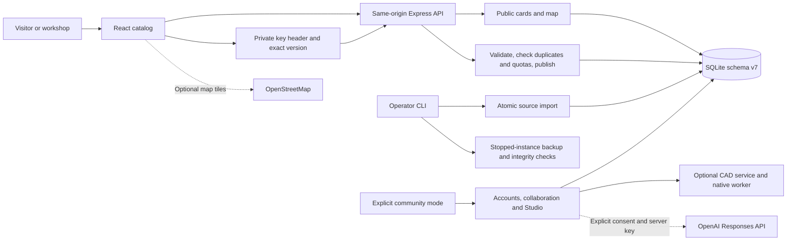

# Architecture

OpenPrint is one self-hosted React/Express application with local SQLite and private filesystem storage. `APP_MODE=catalog` is the default. It exposes the public directory and immediate self-publication without accounts or moderation. `APP_MODE=community` explicitly enables the earlier account, collaboration and Neofab Studio APIs. Both modes use schema v7; choosing catalog mode does not delete community data. The v7 migration widens the project language constraint in a transaction, preserves parent and child rows, checks foreign keys and restores enforcement.

In catalog mode, the API permits health/bootstrap and directory routes. Account, profile, order, file, Studio and moderator endpoints return not found, including for existing session cookies. Bootstrap does not expose old accounts, demo identities or community statistics. Directory queries exclude registered profiles. The application does not construct `CadService`, resume queued CAD work or run community upload cleanup in this mode.

`server/directory.ts` combines imported and self-published catalog cards, plus eligible account-owned profiles only in community mode. `/api/directory` paginates cards, while `/api/directory/map` returns matching coordinates independently, with total/mappable/unmapped counts and an explicit 50,000-point cap. Counts and rows share one SQLite read snapshot, including during an external import. Catalog identities never grant account, verification or order permissions.

## Catalog publication and data separation

`catalog_studios` contains only allowlisted operator-imported fields, source attribution and stable source-derived public IDs. `scripts/catalog-import.ts` validates a nonempty snapshot of at most 50,000 rows and 50 MiB before atomically replacing one source. It never changes self-published rows or user profiles. An incoming batch that exactly overlaps an active self-published workshop is rejected before deleting the previous source. Source datasets stay outside Git. See [catalog setup](CATALOG_IMPORT.md).

`directory_submissions` separately stores self-published details, a random public UUID, SHA-256 of the management key, a hash of the initial normalized request, version and timestamps. The browser generates the 256-bit key. The private link places it in the URL fragment, which is removed from the address before optional map content mounts; management requests use `X-Catalog-Key`. The browser keeps pending creation/access in session storage and offers a private-link download. The server never returns the key or its hash in a public or management response. Private responses use `Cache-Control: private, no-store`.

Creation, duplicate rejection and quota reservation run in one `BEGIN IMMEDIATE` transaction. Name and city are required, together with an HTTP(S) website or a syntactically valid phone number; coordinates must be a finite pair or both null. The submitter must explicitly confirm publication rights. Valid records commit directly into the public directory, without a pending/moderation state or a user row. A Unicode-normalized name/city/address match against imported or active self-published records returns a generic duplicate error. An index enforces the same identity among active self-published rows. These checks do not verify business ownership or catch every spelling variation.

The same key plus the same initial normalized body replays an existing create without consuming another slot, even if the card was subsequently edited. Reusing the key with a different initial body conflicts. Updates require the current version and increment it; concurrent stale edits fail. Deletion clears every public contact/content field and retains a minimal identity/hash/version/timestamp tombstone. The old key can replay a deletion but cannot republish or resurrect the card. There is no account recovery for a lost key.

`directory_create_usage` records only successful creates, with an HMAC of the server-observed IP using a random persistent instance salt in `meta`. Raw IPs and plaintext management keys are not stored in these tables. A transaction enforces five creates per IP and 200 per instance over 24 hours, including after deletion or restart. Expired usage rows are purged in a subsequent successful creation transaction; the retained ledger is bounded by the instance quota. Management reads are throttled to 60 per IP/minute, while edits/deletions share 20. Creation attempts have a separate 20/minute throttle alongside the general API limit. Mutation Origin/JSON checks and explicit trusted-proxy configuration remain in force.

The total self-published identity limit is 50,000, including tombstones; this bounds permanent replay metadata. It is independent of the map-point cap and per-source import cap. Switching modes or removing a card does not reset usage. Backups contain the database, including private hashes and the IP salt, and require private storage.

## Localization

`shared/locales.ts` defines the 50 supported locale identifiers and writing directions. English and Russian source strings are authored in code; `scripts/i18n-extract.mjs` creates stable, collision-checked identifiers and the translation inventory. Other dictionaries are committed JSON data. The browser downloads only the selected dictionary, preserves drafts when switching, retries failed downloads, and ignores responses for superseded language selections. It saves the preference when browser storage permits it and updates document language and direction.

The server uses the same dictionaries for deterministic Studio text; `npm run build` copies them into `build/locales` for Node and Docker installations. User-supplied names, descriptions, project text and geometry are not automatically translated. Project languages are stored independently of the current interface preference. AI language requests do not establish translation or engineering quality. Source changes must regenerate the inventory, update dictionaries and pass the completeness and placeholder checks described in [localization maintenance](i18n/README.md).

## Source files

| Location                                                                             | Responsibility                                                                                 |
| ------------------------------------------------------------------------------------ | ---------------------------------------------------------------------------------------------- |
| `src/App.tsx`, `src/core.tsx`                                                        | Navigation, state, localization, cancelled requests, notifications                             |
| `src/CatalogApp.tsx`, `src/CatalogEditor.tsx`, `src/CatalogLocationPicker.tsx`       | Default catalog shell, anonymous editor, private-link management and optional map picker       |
| `server/directory.ts`, `server/directory-submissions.ts`, `shared/directory.ts`      | Public discovery, self-publication, key/version checks, duplicate checks and persistent quotas |
| `src/Browse.tsx`                                                                     | Overview, directory, profiles, project board                                                   |
| `src/NewProject.tsx`, `src/Project.tsx`                                              | Briefs, offers, acceptance, delivery, conversations                                            |
| `src/Workspace.tsx`                                                                  | Dashboard, provider profile, export, password, removal                                         |
| `src/Models.tsx`, `src/Tools.tsx`                                                    | Licensed model sharing and browser-only tools                                                  |
| `server/app.ts`                                                                      | Routes, validation, permissions and error responses                                            |
| `server/domain.ts`                                                                   | Brief access, offer revisions, atomic acceptance, thread membership                            |
| `server/database.ts`                                                                 | Schemas v1–v7, transactions, indexes, immutable snapshot triggers                              |
| `src/Studio.tsx`, `shared/studio.ts`                                                 | Private CAD/CAM brief editor, components, confirmation and handoff                             |
| `server/studio.ts`, `server/studio-ai.ts`, `server/ai-ledger.ts`, `server/cad-ai.ts` | Ownership/version gates, shared AI call ledger, private CAD proposals, bounded Responses API   |
| `server/studio-geometry.ts`                                                          | Deterministic FDM template checks, STL and packet manifests                                    |
| `shared/cad.ts`, `server/cad.ts`, `server/cad-data.ts`                               | Declarative CAD contracts, revisions, grants and exact handoffs                                |
| `server/cad-runner.ts`, `cad-worker/`                                                | Durable queue, bounded native process, CadQuery compiler and artifact validation               |
| `src/CadStudio.tsx`, `src/cad-preview.tsx`, `src/JobCad.tsx`                         | CAD editing, assembly preview and quotation-file access                                        |
| `server/security.ts`                                                                 | Password hashing, sessions, bounded throttles, permission guards                               |
| `server/files.ts`                                                                    | Headers, names, quotas, ownership, reads and cleanup                                           |
| `server/demo.ts`                                                                     | Opt-in fictional accounts and projects; operator catalogues import separately                  |
| `shared/validation.ts`, `shared/parts.ts`                                            | Schemas, exact minor-unit amounts, deterministic meshes                                        |
| `scripts/`, `tests/`                                                                 | Operator tools, backup, API/state/security and browser tests                                   |

## Optional community: data and access

The following workflows are enabled by `APP_MODE=community`. They remain stored when catalog mode is selected, but their APIs and account-based permissions are not exposed there.

`users` have a self-asserted email, scrypt password hash and server-owned role. Email ownership is not automatically verified. `sessions` store only SHA-256 digests of random 256-bit tokens; the raw token is in an HttpOnly cookie, never localStorage. Seven-day sessions are revoked on logout, recovery, password change and account closure as appropriate.

Operator setup creates a one-use token that can activate administrator privileges **only on redemption**, in the same transaction that changes the password and revokes prior sessions. An already registered email address does not gain privileges while a setup link is pending. Recovery with `--recover` never promotes a member.

One `profile` belongs to one user and represents a workshop, an engineer or both. All members can request work. A published provider profile is needed to offer work or start a prospective conversation. A moderator badge is a community review, not identity/quality certification.

`jobs` have public or direct briefs. Public briefs remain readable by URL after closure but leave the open board. Direct briefs are visible to the customer and selected target provider. Moderation hides public content while retaining necessary access for the owner/assigned participant.

`files` contain random storage names, owner IDs, sizes, SHA-256 and download names. They are never served by static middleware. A job attachment is available only to its owner and chosen provider. Approved library models are intentionally public. Moderators can download library submissions through a dedicated endpoint, not a blanket customer-attachment API.

`offers` are immutable revisions. A new price creates a new row. Database triggers protect terms, accepted status and agreement snapshots. Unique partial indexes enforce one active revision per provider/project and one accepted offer per project.

`conversations` are per project/provider, including questions before an offer. Each side has an independent read cursor. Monotonic message IDs support older/newer pagination, up to 50 per response. Hidden bodies are not returned. `reports`, `blocks` and `events` support moderation, contact preferences and decision history. Reported private-message content is available to moderators in the report-review context. Operators still have technical database/filesystem access.

`models` require attribution, explicit CC licensing, a rights acknowledgement and moderator approval. A third-party model URL is not treated as evidence of redistribution rights.

## Optional community: exact acceptance

1. The browser displays price, currency, days, scope and revision in a confirmation dialog.
2. It submits the offer UUID/revision and displayed project version.
3. A synchronous `BEGIN IMMEDIATE` transaction validates ownership, open state, version, the exact active offer and provider availability/blocks.
4. One offer is accepted, competitors are closed, and a separate accepted-terms snapshot is recorded.
5. The notification and audit record commit in the same transaction. No external service can roll back the agreement or change its price.
6. A stale or concurrent acceptance returns a conflict; the user must review the current state.

Workflow: `open → assigned → delivered → completed`. The chosen provider marks delivery; the customer confirms completion. Only an open project can be cancelled. There is no escrow or automatic arbitration after assignment.

## Optional community: files and tools

Uploads are authenticated, Origin-checked raw byte requests capped at 20 MB, with user/instance quotas. Attachments support STL, OBJ, STEP/STP, GLB and 3MF. Header checks prevent simple type confusion, **not malware or full CAD validation**. The server does not unpack uploaded 3MF or compile uploaded executable source. The separate optional CAD path accepts only its strict JSON specification. Downloads use attachment disposition and `nosniff`.

STL/OBJ preview and parametric construction run locally in the browser. Coordinates are interpreted as millimeters; volume may be wrong for open/self-intersecting meshes. Simple generated meshes are checked against analytical volume and two-face edge incidence, not physically certified. Generated STL is uploaded only when a signed-in user publishes a project.

Unreferenced uploads older than 24 hours are removed hourly while the app runs, or by `npm run cleanup`. Referenced files do not expire. Filesystem and database operations are not a distributed transaction; cleanup or operator recovery may be needed after storage failure.

## Optional community: Neofab Studio and CAD

Studio keeps private projects and revisions in the shared SQLite schema v6. The owner edits a brief and confirms an exact version and content hash for discussion/quotation. Open questions, assumptions and unknown component quantities remain explicit in the handoff; confirmation does not release production. Request intent chooses design/consultation or manufacturing quotation independently of geometry support. Publication freezes that version into one job and a downloadable packet; retries return the existing job. A project may use an explicitly selected FDM template or an optional declarative CAD design. See [setup and limits](NEOFAB_SETUP.md).

CAD specification edits and removal advance the Studio version and clear confirmation. `studio_cad_revisions` preserves each specification and hash; `studio_cad_builds` binds a request ID to the owner, revision and brief version. A single local worker executes queued jobs. Successful results remain immutable; an older build finishing after an edit remains historical and cannot satisfy confirmation of the current version. After restart, interrupted running jobs fail explicitly and eligible queued jobs resume. Cancellation and account deletion cannot restore removed project data through a late result.

The compiler accepts `neofab-cad/1` data, never generated Python. It builds bounded parts and assemblies with CadQuery/OpenCascade, then emits STEP/STL, per-part files, BOM, source JSON, a mesh and geometry report. The server checks the complete allowlisted artifact set, spec identity, report/mesh component IDs, sizes and SHA-256 before storing anything. CAD artifacts are bounded SQLite BLOBs in `studio_cad_artifacts`; a database snapshot therefore contains their exact bytes. Temporary working directories are private and removed after execution. See [compiler provenance and runtime boundaries](CAD_ENGINE.md).

The confirmed packet records the CAD revision/build, compiler version, specification hash and artifact hashes. `studio_cad_handoffs` binds that packet to a published job. Owners and accepted providers can read it. The recipient of a direct request receives a grant at publication; for a public request the owner may grant/revoke a named conversation participant's access for quotation. Public job visibility alone never grants file access. CAD access grants do not change the rules for ordinary uploaded attachments or licensed public-library models.

Attempt and output quotas are checked before compute. CAD daily usage counts retained `cad.queued` events, so account closure cannot erase instance accounting. Limits cover 30 builds per project, 10 per user/day, 100 per instance/day, 128 MiB per result, and 256 MiB/user and 2 GiB/instance of registered CAD artifacts. Specification history has separate size limits. These limits do not include all database/WAL, temporary-storage or backup overhead.

Optional AI assistance calls one fixed provider endpoint with the idea, saved brief and user instruction after explicit consent. CAD requests also include the current declarative specification. The server holds the key, routes by task, validates structured output and records attempted calls before network I/O. Brief and CAD tasks share project/user/instance limits and running-request limits. Stale AI results cannot overwrite a newer revision. User deletion removes private project content while preserving the minimal usage ledger for the anonymized account. These are attempt/token limits, not monetary reservations.

AI CAD results are immutable private proposals with a source brief version, CAD revision and confirmation state. A separate reviewed apply request uses the same CAD save/quota/version path as manual edits. It cannot build, confirm or publish. The provider schema converts homogeneous tuple definitions into fixed-length arrays and disjoint operation unions into `anyOf`; the complete local schema still checks ranges, geometry structure and total limits. Passing that schema does not establish semantic or engineering correctness. The user inspects the compiled result and confirms the exact package before publication.

The current flat component list and textual operations are the first step toward the [universal CAD/CAM architecture](NEOFAB_BLUEPRINT.md), not a functioning multi-provider manufacturing graph.

## Runtime boundaries

One process, local disk, exact public HTTPS origin, explicit proxy configuration and a private data directory. No cloud secret is required. No operator/API secret is embedded into the frontend; a self-publication management key is generated locally and held only for its listing. The map and 3D modules load separately from the initial overview.

No end-to-end encryption, automatic email verification, team memberships, horizontal scaling, SSR, payments, SMTP outbox or federation is included. Optional CAD is a resource-limited local native process with a scrubbed environment, not a complete filesystem/network sandbox. There is no CAM/G-code, FEA, autonomous multi-agent delegation or automatic manufacturing release. The optional catalog importer uses an operator-supplied, rights-cleared snapshot; no production account/order migration from the original service is supplied. Backups require the app to be stopped: see [SELF_HOSTING.md](SELF_HOSTING.md).

Source and release delivery through GitHub does not host the running service. Express mutations, SQLite persistence and optional native CAD need a Node-capable host or local installation; GitHub Pages cannot run this backend.
