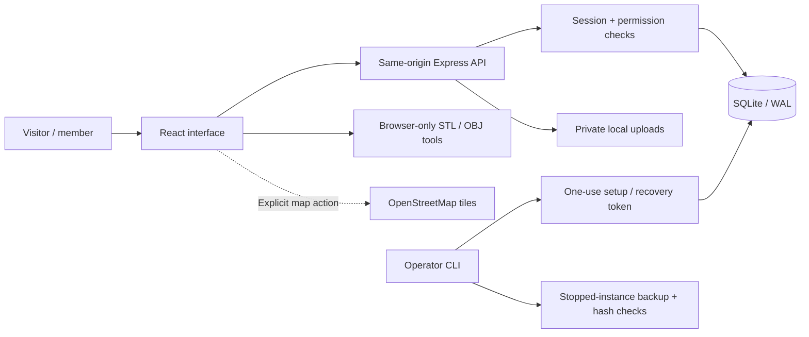

# Architecture

OpenPrint is a single self-hosted application: React, Express, local SQLite and private filesystem storage. Primary community workflows do not call a cloud provider.

## Code map

| Location                                  | Responsibility                                                      |
| ----------------------------------------- | ------------------------------------------------------------------- |
| `src/App.tsx`, `src/core.tsx`             | Navigation, state, localization, cancelled requests, notifications  |
| `src/Browse.tsx`                          | Overview, directory, profiles, project board                        |
| `src/NewProject.tsx`, `src/Project.tsx`   | Briefs, offers, acceptance, delivery, conversations                 |
| `src/Workspace.tsx`                       | Dashboard, provider profile, export, password, removal              |
| `src/Models.tsx`, `src/Tools.tsx`         | Licensed model sharing and browser-only tools                       |
| `server/app.ts`                           | Routes, validation, permissions and error responses                 |
| `server/domain.ts`                        | Brief access, offer revisions, atomic acceptance, thread membership |
| `server/database.ts`                      | Schema v1, transactions, indexes, immutable-agreement triggers      |
| `server/security.ts`                      | Password hashing, sessions, bounded throttles, permission guards    |
| `server/files.ts`                         | Headers, names, quotas, ownership, reads and cleanup                |
| `server/demo.ts`                          | Opt-in fictional local demo, isolated from real data                |
| `shared/validation.ts`, `shared/parts.ts` | Schemas, exact minor-unit amounts, deterministic meshes             |
| `scripts/`, `tests/`                      | Operator tools, backup, API/state/security and browser tests        |

## Data and access

`users` have a self-asserted email, scrypt password hash and server-owned role. Email ownership is not automatically verified. `sessions` store only SHA-256 digests of random 256-bit tokens; the raw token is in an HttpOnly cookie, never localStorage. Seven-day sessions are revoked on logout, recovery, password change and account closure as appropriate.

Operator setup creates a one-use token that can activate administrator privileges **only on redemption**, in the same transaction that changes the password and revokes prior sessions. An already registered email address does not gain privileges while a setup link is pending. Recovery with `--recover` never promotes a member.

One `profile` belongs to one user and represents a workshop, an engineer or both. All members can request work. A published provider profile is needed to offer work or start a prospective conversation. A moderator badge is a community review, not identity/quality certification.

`jobs` have public or direct briefs. Public briefs remain readable by URL after closure but leave the open board. Direct briefs are visible to the customer and selected target provider. Moderation hides public content while retaining necessary access for the owner/assigned participant.

`files` contain random storage names, owner IDs, sizes, SHA-256 and download names. They are never served by static middleware. A job attachment is available only to its owner and chosen provider. Approved library models are intentionally public. Moderators can download library submissions through a dedicated endpoint, not a blanket customer-attachment API.

`offers` are immutable revisions. A new price creates a new row. Database triggers protect terms, accepted status and agreement snapshots. Unique partial indexes enforce one active revision per provider/project and one accepted offer per project.

`conversations` are per project/provider, including questions before an offer. Each side has an independent read cursor. Monotonic message IDs support older/newer pagination, up to 50 per response. Hidden bodies are not returned. `reports`, `blocks` and `events` support moderation, contact preferences and decision history. Reported private-message content is available to moderators in the report-review context. Operators still have technical database/filesystem access.

`models` require attribution, explicit CC licensing, a rights acknowledgement and moderator approval. A third-party model URL is not treated as evidence of redistribution rights.

## Exact acceptance

1. The browser displays price, currency, days, scope and revision in a confirmation dialog.
2. It submits the offer UUID/revision and displayed project version.
3. A synchronous `BEGIN IMMEDIATE` transaction validates ownership, open state, version, the exact active offer and provider availability/blocks.
4. One offer is accepted, competitors are closed, and a separate accepted-terms snapshot is recorded.
5. The notification and audit record commit in the same transaction. No external service can roll back the agreement or change its price.
6. A stale or concurrent acceptance returns a conflict; the user must review the current state.

Workflow: `open → assigned → delivered → completed`. The chosen provider marks delivery; the customer confirms completion. Only an open project can be cancelled. There is no escrow or automatic arbitration after assignment.

## Files and tools

Uploads are authenticated, Origin-checked raw byte requests capped at 20 MB, with user/instance quotas. Attachments support STL, OBJ, STEP/STP, GLB and 3MF. Header checks prevent simple type confusion, **not malware or full CAD validation**. The server does not unpack 3MF or execute geometry. Downloads use attachment disposition and `nosniff`.

STL/OBJ preview and parametric construction run locally in the browser. Coordinates are interpreted as millimeters; volume may be wrong for open/self-intersecting meshes. Simple generated meshes are checked against analytical volume and two-face edge incidence, not physically certified. Generated STL is uploaded only when a signed-in user publishes a project.

Unreferenced uploads older than 24 hours are removed hourly while the app runs, or by `npm run cleanup`. Referenced files do not expire. Filesystem and database operations are not a distributed transaction; cleanup or operator recovery may be needed after storage failure.

## Runtime boundaries

One process, local disk, exact public HTTPS origin, explicit proxy configuration and a private data directory. No cloud secret is required. No runtime secret is embedded into the frontend. The map and 3D modules load separately from the initial overview.

No end-to-end encryption, automatic email verification, team memberships, horizontal scaling, SSR, payments, SMTP outbox, AI service or federation is included. No production import from the original service is supplied. Backups require the app to be stopped: see [SELF_HOSTING.md](SELF_HOSTING.md).
