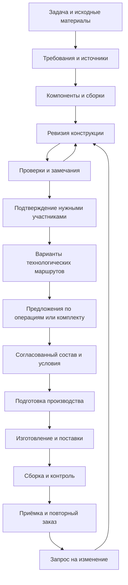

# Neofab: от задачи к изготовленному изделию

Рабочая спецификация от 14 ноября 2026 года. Описывает целевую платформу и границы прототипа; возможности будущих этапов не являются заявлением о готовности текущего приложения. Коммерческие гипотезы и критерии развития — в [NEOFAB_BUSINESS.md](NEOFAB_BUSINESS.md), результаты программных проверок — в [VALIDATION.md](VALIDATION.md).

## 1. Продукт и участники

**Neofab — цифровая фабрика, в которой человек или компания проектирует изделие под свою задачу и выбирает исполнителей для его изготовления.** Общая единица работы — версионируемый проект: от одной запасной детали до сложной сборки, мебели или малой серии. 3D-печать, фрезеровка, токарная обработка, раскрой, листовые операции и сборка входят в одну систему через собственные технологические адаптеры.

Платформа должна помогать и человеку без CAD-навыков, и инженеру с готовой документацией. Входом могут стать описание, измерения, чертёж, исходная модель или спецификация. Возможность принять файл, понять его содержимое, проверить геометрию и подготовить производство — отдельные уровни поддержки.

| Участник              | Что получает                                                                      | Что подтверждает                                                            |
| --------------------- | --------------------------------------------------------------------------------- | --------------------------------------------------------------------------- |
| Заказчик              | Понятное ТЗ, варианты конструкции, сравнимые предложения, историю изменений       | Назначение, исходные размеры, бюджет, выбранную ревизию и результат приёмки |
| Конструктор           | Структурированные требования, исходные данные, параметры, историю решений         | Соответствие конструкции согласованным требованиям в пределах своей работы  |
| Технолог / мастерская | Комплект для расчёта, маршрут, критерии качества, перечень неопределённостей      | Выполнимость операций на своём оборудовании, режимы, срок и цену            |
| Координатор сборки    | Состав изделия, зависимости между операциями, поставки и результаты контроля      | Готовность комплектующих к следующей операции и сборке                      |
| Автор конструкции     | Атрибуцию, версии, повторное использование и условия доступа                      | Происхождение и условия распространения своих материалов                    |
| Оператор сообщества   | Управление участниками, модерацию, историю действий, эксплуатационные инструменты | Процедуры работы конкретного сообщества и своей инфраструктуры              |

Ключевые сценарии:

- **Ремонт и запасные части:** исходный образец или чертёж → измерения сопряжений → восстановленная конструкция → изготовление → проверка посадки и функции.
- **Малые серии B2B:** спецификация и количество → прототип → утверждение первого изделия → партия → выборочный или полный контроль по согласованному плану.
- **Сложные инженерные сборки:** дерево компонентов → интерфейсы → отдельные маршруты → закупные элементы → сборка → функциональная проверка.
- **Мебель и интерьер:** размеры помещения и изделия → панели/каркас/фурнитура → раскрой/сверление/обработка → отделка → сборка и доставка.
- **Индивидуальные изделия:** пользовательские размеры и предпочтения → параметрический вариант → выбор материала и технологии → локальное изготовление.

Пилоты выбираются по наличию заказчиков и исполнителей. Они ограничивают объём конкретного эксперимента, сохраняя универсальную модель проекта.

## 2. Что существует и что предстоит сделать

Термины статуса:

- **Реализовано:** функция существует в исходном коде OpenPrint; объём проверки указан отдельно в `VALIDATION.md` и CI конкретного коммита.
- **Прототип:** реализуемый в этой ветке объём Neofab Studio; его нельзя приравнивать к промышленной CAD/CAM-системе или доказанному производству.
- **Настраивается:** путь зависит от явно подключённого провайдера и доступных оператору моделей. Наличие настройки не подтверждает успешный вызов API.
- **Планируется:** архитектурное решение или следующая интеграция, отсутствующая в текущем сквозном процессе.

| Возможность                                                                                            | Статус и фактический объём                                                                     | Что ещё требуется                                                                                     |
| ------------------------------------------------------------------------------------------------------ | ---------------------------------------------------------------------------------------------- | ----------------------------------------------------------------------------------------------------- |
| Профили мастерских и инженеров, заявки, сообщения, предложения                                         | Реализовано в открытом MIT-проекте [OpenPrint](https://github.com/ultim8digital/openprint)     | Команды, детальные производственные способности, полномочия участников                                |
| Фиксация точной версии предложения, выдача файла выбранному исполнителю, доставка и приёмка заказчиком | Реализовано для одного выбранного исполнителя на заявку                                        | Заказы по операциям, частичные поставки, изменения после согласования                                 |
| STL/OBJ-просмотр и три параметрические формы                                                           | Реализованы блок, пластина с отверстием и труба; геометрия строится программно                 | Полноценный CAD, сборки, размерные чертежи, дополнительные форматы                                    |
| Neofab Studio: идея → редактируемое ТЗ → подтверждение → заявка                                        | Прототип этой ветки                                                                            | Проверки на реальных задачах и доработка по результатам                                               |
| Состав изделия и операции в Studio                                                                     | Прототип: ограниченные списки компонентов, требований, операций, допущений и критериев приёмки | Иерархическая BOM, ссылки между компонентами и граф зависимостей                                      |
| ИИ для подготовки структурированного ТЗ                                                                | Настраиваемый необязательный вызов Responses API; ручной путь сохраняется                      | Доказательство качества на собственной выборке и управление денежным бюджетом                         |
| Подбор исполнителей                                                                                    | Прототип: сопоставление с реальными полями опубликованных профилей и объяснение совпадений     | Подтверждённые возможности станков, мощности, сроки, география поставки и отклики                     |
| Neofab CAD worker                                                                                      | Существует отдельная разработка с декларативной геометрией CadQuery                            | Интеграция с этой платформой, изоляция задач, многопользовательские права и эксплуатационная проверка |
| Автоматическая подготовка CAM                                                                          | Планируется                                                                                    | Адаптеры технологий, профили оборудования, проверка траекторий и производственные испытания           |
| Физическое качество изделий                                                                            | Не установлено программными тестами                                                            | Измерения, протоколы испытаний, подтверждение исполнения реальных заказов                             |

Отдельный CAD worker не подключён к текущему маршруту Studio. Наличие у него MIT-лицензии и работающей декларативной геометрии не означает наличия CAM или готовности к работе с независимыми пользователями.

Текущий Studio способен оформить широкую производственную задачу, но генерация геометрии ограничена тремя шаблонами. Метка CNC, мебели или смешанного процесса в ТЗ означает классификацию запроса, а не автоматическое построение модели или управляющей программы. Данные BOM в ТЗ пока не создают отдельные договоры с несколькими исполнителями.

## 3. Единая цепочка проекта

У проекта нет единственного универсального статуса, который одновременно описывает проектирование, закупку и производство. Требования, конструкция, отдельные операции и коммерческие соглашения имеют собственные состояния. Сводный статус вычисляется из них и показывает блокирующую зависимость: например, «ожидается подтверждение посадочного размера», «две детали изготовлены, одна на покрытии».

Состояния будущего маршрута: `draft → needs_information → design_review → ready_for_quote → quoted → agreed → in_production → inspection → accepted`. Отдельно предусмотрены `on_hold`, `change_requested`, отмена и частичная приёмка. Переходы разрешаются проверками и полномочиями, а не текстовым решением ИИ.

## 4. Предметная модель

Эта модель задаёт будущую структуру хранения. Плоское ТЗ прототипа является первым входным форматом, а не полной реализацией всех сущностей.

| Сущность               | Обязательные связи и данные                                                                                                       |
| ---------------------- | --------------------------------------------------------------------------------------------------------------------------------- |
| `Project`              | Владелец/организация, назначение, участники и роли, конфиденциальность, язык, действующая согласованная версия                    |
| `Requirement`          | Объект требования, значение и единица, допустимый диапазон, источник, автор, состояние подтверждения, способ проверки             |
| `Evidence`             | Измерение, документ, фото, CAD-файл, утверждение участника или результат проверки; версия и дата; права доступа                   |
| `Component`            | Стабильный ID детали/сборки, make/buy, количество, единица, материал, связанные требования и ревизии                              |
| `BOMRevision`          | Версия состава, вложенные компоненты, количества на сборку, закупные позиции, допустимые замены                                   |
| `DesignRevision`       | Родительская версия, параметры, исходная декларация/CAD, авторство изменений, хеши артефактов и требования, которые она реализует |
| `Interface`            | Сопрягаемые компоненты, посадки, крепёж, соединения, диапазоны движения и требования к совместимости                              |
| `Artifact`             | Назначение файла, формат, единицы, источник, хеш, версия инструмента, входные хеши, доступ и срок хранения                        |
| `ProcessRouteRevision` | Граф операций для компонентов, зависимости, входные и выходные артефакты, альтернативные маршруты                                 |
| `Operation`            | Технология, объём работы, требуемое оборудование, материал/заготовка, входной контроль, критерии выхода                           |
| `CheckRun`             | Тип и версия проверки, точные входы, результаты, доказательства, замечания, область применимости                                  |
| `Capability`           | Заявленные и подтверждённые возможности исполнителя, источник подтверждения и актуальность                                        |
| `QuoteRevision`        | Ревизии конструкции/BOM/маршрута, операции, цена и валюта, срок, допущения, исключения, контроль, логистика                       |
| `WorkOrder`            | Принятое предложение, ответственный исполнитель, входная готовность, поставки, результаты контроля                                |
| `AcceptanceRecord`     | Проверенный результат, измерения, принятые/отклонённые позиции, автор решения, связанные требования                               |
| `ChangeRequest`        | Причина изменения, затронутые версии/заказы, влияние на сроки/цену, решение сторон                                                |

Количество на строке BOM и количество изделий в заказе хранятся отдельно. Например, 20 сборок с четырьмя втулками требуют 80 втулок; запас на настройку/брак указывается отдельной согласованной величиной. Один и тот же компонент может использоваться в нескольких изделиях без потери его версии.

### Требования и происхождение данных

Для каждого существенного числа нужно различать: «сообщил заказчик», «измерил исполнитель», «извлечено из чертежа», «получено расчётом», «предложено ИИ», «подтверждено инженером». Фото без масштаба не становится точным размером. Неизвестное значение сохраняется неизвестным; допущение отображается рядом с результатом и требует решения перед зависимой операцией.

Требование «вал должен входить во втулку» преобразуется в перечень уточнений: измеренные размеры, желаемый тип посадки, материал, температура, нагрузка, метод проверки. Ответственный специалист определяет необходимые значения и методы по фактическому назначению. Модель не назначает точность производства из одного названия материала.

### Версии и подтверждение

Подтверждение связывается с хешем содержимого, номером версии и областью решения. Подтверждение ТЗ заказчиком, проверка конструкции инженером и выпуск задания технологом — разные события. Изменение исходного размера помечает зависимые CAD-артефакты, проверки, маршруты и предложения устаревшими. Новый результат не перезаписывает ранее согласованные условия.

До начала работы возможны новые котировки. После начала производства изменение оформляется отдельно: кто уже потратил материал и время, что можно использовать, что требуется изготовить заново, какие дополнительные условия приняли стороны.

## 5. Технологии и адаптеры

Внешний адаптер получает неизменяемый набор входов и возвращает артефакты, измеримые результаты и сообщения об ограничениях. Контракт включает `adapter_version`, хеши входов, версию профиля оборудования, единицы, лимиты ресурсов, статус и журнал. Секреты подключения к станкам и провайдерам не входят в переносимый проект.

| Семейство                                  | Проектные артефакты                                                  | Производственная подготовка                                             | Текущее состояние                                                           |
| ------------------------------------------ | -------------------------------------------------------------------- | ----------------------------------------------------------------------- | --------------------------------------------------------------------------- |
| FDM/FFF                                    | Исходная конструкция, STL/3MF, требования к ориентации и поверхности | Слайсер, принтер/сопло, материал, поддержка, режимы, просмотр G-code    | ТЗ и простые STL-шаблоны; слайсер не интегрирован                           |
| SLA/DLP, SLS/MJF, металлическая печать     | Геометрия, материал, ориентация, критические размеры                 | Специфические подготовка, размещение, поддержка и последующая обработка | ТЗ; технологические адаптеры планируются                                    |
| Фрезеровка и токарная обработка            | STEP/исходный CAD, чертёж и допуски                                  | Заготовка, установки, инструмент, траектории, симуляция, постпроцессор  | ТЗ; CAM планируется                                                         |
| Лазер, гидроабразив, плазма                | DXF/SVG или геометрия листа, толщина, материал                       | Контуры, ширина реза, перемычки, раскладка, режимы под оборудование     | ТЗ; геометрический и CAM-адаптеры планируются                               |
| Листовой металл                            | Модель детали, развёртка, таблица гибов                              | Раскрой, гибка, соединения, последовательность, контроль                | ТЗ; расчёт развёрток и маршрут планируются                                  |
| Мебель и дерево                            | Параметрическая сборка, панели, каркас, фурнитура                    | Раскрой, направление волокон, кромка, отверстия, CNC, отделка           | Можно описать состав и операции; специализированные инструменты планируются |
| Закупные детали, ремонт, покрытие и сборка | Спецификация, альтернативы, интерфейсы, инструкция                   | Поиск компонентов, входной контроль, ремонтные операции, сборка         | ТЗ и коммуникация; отдельные заказы и контроль зависимостей планируются     |

CadQuery позволяет строить параметрическую геометрию и экспортировать, в частности, STEP, STL, 3MF и DXF. Параметрическая история требует сохранения исходной модели, поскольку обменные форматы не переносят её автоматически. Это обоснование хранения исходников вместе с экспортами, а не утверждение о готовом универсальном CAD-редакторе. [CadQuery: введение](https://cadquery.readthedocs.io/en/latest/intro.html), [импорт и экспорт](https://cadquery.readthedocs.io/en/latest/importexport.html).

CAM зависит от производственного контекста. PrusaSlicer требует выбора принтера, материала и профиля печати. Для CNC постпроцессор должен соответствовать станку; в лазерной обработке ширина реза зависит от материала, толщины и настроек. Поэтому одинаковый файл конструкции не гарантирует одинаковую управляющую программу для разных исполнителей. [PrusaSlicer](https://help.prusa3d.com/article/first-print-with-prusaslicer-2-9_1753), [Autodesk: post processing](https://help.autodesk.com/cloudhelp/ENU/Fusion-CAM/files/MFG-POST-PROCESSING-OVERVIEW.htm), [LightBurn: kerf](https://docs.lightburnsoftware.com/latest/Guides/Test-KerfOffset/).

### Подключение CAD worker

Первый контракт интеграции — версия разрешённой декларативной схемы → изолированное задание → CAD-артефакты и отчёт. Пользовательский текст не передаётся в `eval` или неограниченный Python. Worker работает с ограничениями CPU, памяти, времени, размера геометрии и файлов; получает только разрешённые входы, без ключей приложения и доступа к чужим заданиям. Выход проверяется до публикации.

Для начала нужны очередь, отмена, идемпотентный ключ задания, фиксированная версия CadQuery/OpenCascade и образа среды, привязка результата к версии проекта. Требуется проверять восстановление после падения и устаревание результата, если пользователь успел изменить проект. Многопользовательская готовность устанавливается отдельными проверками, а не переносом рабочего локального скрипта на сервер.

## 6. ИИ и выбор моделей

Оркестратор приложения хранит состояние и выбирает разрешённый следующий шаг. Каждая ИИ-задача имеет небольшой вход, схему результата, критерии качества и бюджет. Модель предлагает данные; сервер применяет разрешённые изменения после проверок и необходимого подтверждения участника.

Structured Outputs ограничивает форму завершённого ответа заданной JSON-схемой. Отказы, неполные ответы, ошибки API и правила предметной области остаются обязанностью приложения. Соответствие схеме не является проверкой инженерной истинности. [OpenAI: Structured Outputs](https://developers.openai.com/api/docs/guides/structured-outputs?api-mode=responses).

### Предлагаемая политика роутера

Это целевая политика, а не перечень уже настроенных в этой установке моделей. Роли `economy`, `technical`, `review` привязываются оператором к доступным API-моделям. Как начальные кандидаты на дату документа: Luna для ограниченных текстовых задач, GPT-6.1 Sol для сложного технического разбора, Astra для трудных неоднозначных случаев. Официальная документация рекомендует сравнивать модели на одинаковых входах и сохранять наиболее лёгкую конфигурацию, проходящую критерии качества. Доступность и параметры зависят от конкретной модели и аккаунта. [OpenAI: model selection](https://developers.openai.com/api/docs/guides/model-selection).

| Задача                                                                   | Начальная роль                                                                    | Условие перехода или остановки                                                                                      |
| ------------------------------------------------------------------------ | --------------------------------------------------------------------------------- | ------------------------------------------------------------------------------------------------------------------- |
| Перевод, оформление текста, извлечение явно заданных полей               | `economy`                                                                         | Несовпадение чисел, единиц, артикула или отрицания — отклонить результат; одна попытка исправления                  |
| Структурирование ТЗ и списка уточнений                                   | `economy` для одного компонента; `technical` для нескольких процессов/компонентов | Противоречия или недостающие обязательные данные — вопрос участнику; сильная модель не должна придумывать измерения |
| Разбиение изделия на компоненты и маршрут                                | `technical`                                                                       | Несогласованные интерфейсы или альтернативы — черновики для инженера; сложный случай можно передать `review`        |
| Предложение декларативной CAD-модели                                     | `technical`                                                                       | Валидатор/геометрическое ядро возвращают замечания; не более двух исправлений в пределах бюджета                    |
| Проверка противоречий между требованиями, BOM и документами              | `review` по явному правилу                                                        | Возвращает замечания и ссылки на входные данные; не подписывает выпуск в производство                               |
| Подбор исполнителей и сравнение предложений                              | Детерминированный фильтр; `economy` для объяснений                                | Нет подходящих профилей — показать отсутствие предложения; не выдумывать поставщика, цену или доступность           |
| Суммы, единицы, хеши, переходы состояний, построение шаблонной геометрии | Программный код                                                                   | Ошибка возвращается как ошибка; вызов модели не заменяет расчёт                                                     |

Порог эскалации задаётся наблюдаемым событием: несовпадение значения, провал правила, сложность маршрута, невозможность подтвердить источник. Самооценка модели «уверенность 95%» не используется как разрешение на изготовление. После исчерпания попыток остаются ручное редактирование и работа со специалистом.

Параллельные агенты полезны для независимых сравнений материалов, анализа разных компонентов или перевода документов. Они читают одну зафиксированную версию и возвращают предложения; координатор объединяет их после проверки конфликтов. Независимые агенты не редактируют одновременно одну согласованную ревизию.

### Расходы и воспроизводимость

В прототипе предусмотрены ограничение вызовов на проект, пользователя и установку, максимальный размер ответа и учёт входных/выходных токенов. Денежный лимит требует отдельного счётчика стоимости и резервирования бюджета до запроса; счётчик вызовов его не заменяет. Responses API предоставляет сведения об использовании токенов. [OpenAI: Responses reference](https://developers.openai.com/api/reference/typescript/resources/responses).

Целевой порядок: проверить квоту → зарезервировать верхнюю оценку расходов → выполнить ограниченный запрос → записать использование и результат → сверить остаток. При неизвестной стоимости или исчерпанном лимите автоматический платный вызов не запускается. Нельзя освобождать всю резервацию при сетевом таймауте, если провайдер мог обработать запрос: такой запуск требует сверки.

Хранить ID запуска, проект/версию, роль, фактическую модель, версию схемы/промпта/роутера, лимиты, токены, длительность, результат проверки и причину повторения. Где провайдер поддерживает фиксированный snapshot, закреплять его; при использовании изменяемого алиаса явно записывать это ограничение и повторять оценку качества после изменения. Один и тот же комплект входов должен иметь устойчивый ключ кэша с учётом прав доступа.

Собственная контрольная выборка должна включать русский и английский, десятичные разделители, дюймы/миллиметры, отрицания, допуски, неизвестные размеры, конфликтующие источники, повторные компоненты и смешанные маршруты. Начальный критерий выпуска: все обязательные проверки пройдены, ноль выдуманных числовых требований на контрольной выборке, все намеренно неполные критические входы оставлены неполными. Это критерий данного набора, а не гарантия для любых входов. Дополнительно измеряются точность извлечения, время исправления инженером, доля эскалаций и стоимость принятого результата.

## 7. Проверки и выпуск в производство

| Уровень               | Что проверяется                                                            | Достаточное подтверждение                                          |
| --------------------- | -------------------------------------------------------------------------- | ------------------------------------------------------------------ |
| Данные                | Схема, единицы, диапазоны, количество, обязательные поля, происхождение    | Отчёт валидатора и решения по отсутствующим данным                 |
| Геометрия             | Корректность тела/сетки, размеры, интерфейсы, результат построения         | Отчёт конкретного ядра/алгоритма на точной ревизии                 |
| Технологичность       | Правила выбранного процесса и заявленного оборудования                     | Версия правил и решение технолога по открытым замечаниям           |
| Инженерные требования | Нагрузки, температура, ресурс, посадки и другие требования назначения      | Выбранные ответственным инженером расчёты, измерения или испытания |
| Подготовка станка     | Заготовка, оснастка, инструмент, ноль, профиль, траектории и постпроцессор | Подтверждение исполнителя на фактическом оборудовании              |
| Изделие/партия        | Размеры, комплектность, поверхность, функция, согласованные испытания      | Протоколы и решение заказчика/назначенного контролёра              |

«Геометрия построена», «STL замкнут», «слайсер создал G-code» и «деталь подходит для применения» — разные результаты. Например, для ремонтной втулки важны измеренные сопряжения и условия работы; для мебели — соединения и предусмотренные нагрузки; для сложной сборки — совместимость компонентов и функциональная проверка. Необходимые инженерные подтверждения следуют из этих требований.

Практика цифрового производства также разделяет котировку и проверку перед изготовлением: Xometry описывает экспертную проверку заказа после получения предложения, а Protolabs требует исправить геометрию при обязательных DFM-замечаниях. [Xometry: workflow](https://www.xometry.com/get-started/), [Protolabs: quoting platform](https://www.protolabs.com/help-center/prodesk/).

## 8. Исполнители, предложения и несколько производств

Подбор начинается с проверяемых критериев: операция, материал, габарит, допуски, объём партии, география и условия поставки. В профиле различаются заявление исполнителя, проверенный документ и подтверждение успешным заказом. Отсутствие доказательства показывается явно; общий балл совпадения не превращается в сертификат качества.

В целевом процессе заказчик сможет выбрать одного генерального исполнителя или несколько исполнителей по операциям. Во втором случае назначается координатор, фиксируются ответственность за транспортировку, входной контроль, передачу артефактов и несовместимость результатов. Стоимость маршрута включает подготовки, минимальные партии, передачу между производствами и финальную сборку. Срок вычисляется по зависимостям и подтверждённым срокам поставки, а не суммированием всех операций без учёта параллельности. Текущая заявка поддерживает одного выбранного исполнителя.

Котировка должна указывать точные версии проекта/BOM/геометрии/маршрута, количество, цену, срок действия, условия контроля, исключения и срок исполнения. Сравниваются одинаковые объёмы: предложение без покрытия или измерений не показывается как просто более дешёвый эквивалент.

Доступ к файлам для предварительной оценки предоставляется конкретному исполнителю на конкретную ревизию с журналом выдачи. Это будущая функция: базовая OpenPrint сейчас открывает прикреплённый файл после выбора исполнителя. Для профессионального расчёта до принятия заказа потребуется согласованный процесс выдачи данных; его нельзя подменять публикацией конфиденциальных файлов.

## 9. Открытое ядро и эксплуатация

Открытое ядро сохраняет полезный путь без обязательного ИИ: собственная установка, ручное ТЗ, участники, предложения, файлы, экспорт и история. Дополнительные адаптеры подключаются через версионируемые интерфейсы. Хостинг, обслуживаемые вычисления, поддержка, командные процессы и коммерческие интеграции могут оплачиваться отдельно.

Публичный код не публикует пользовательские проекты, клиентские чертежи или производственные профили автоматически. Лицензия программного кода, права на конструкцию, условия доступа к производственным данным и условия коммерческой услуги учитываются раздельно. Для каждого опубликованного шаблона нужны источник и явные условия использования.

Текущая база — один процесс, SQLite и локальное файловое хранилище. До распределённых производственных задач требуются устойчивые фоновые задания, изоляция вычислений и повторяемое восстановление. Переход к нескольким серверам, общей БД и объектному хранилищу выполняется при измеренной потребности; сам по себе перенос в облако не добавляет версионирование и производственную достоверность.

## 10. Что считать следующим законченным результатом

Ближайший программный результат: пользователь создаёт ТЗ для детали или сборки, видит компоненты, операции, допущения и вопросы, исправляет данные, подтверждает конкретную версию и передаёт её в реальную заявку. Для поддержанного шаблона прикладывается воспроизводимый STL; для остальных задач ясно указано, что требуется работа конструктора/технолога.

Следующий производственный результат: исполнители получают согласованный комплект, возвращают сравнимые условия, изготавливают результат и прикладывают доказательства согласованных проверок. Для проекта с несколькими технологиями должны прослеживаться версии компонентов, передачи между операциями и финальная приёмка. Успех этого сценария, а не число сгенерированных моделей, определяет готовность расширять автоматизацию.
